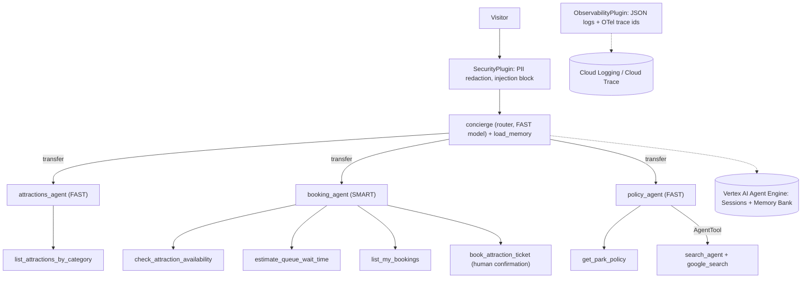

# Desert Peaks Park Concierge 🎢

A multi-agent visitor concierge for **Desert Peaks Park**, a *fictional* theme park, built with the
[Google Agent Development Kit (ADK)](https://google.github.io/adk-docs/) for the **AI in 5 Days (L200)** course.

**Problem:** theme-park visitors juggle separate apps and long FAQ pages to find rides that fit
their group, check availability, see queue times and book tickets.
**Solution:** one conversational concierge that routes each request to a specialist agent, uses
strict, validated tools, asks for confirmation before spending money, remembers preferences across
visits, and is fully observable, tested and deployed with CI/CD.

> All park names, prices and policies are mock data in [`park_concierge/data.py`](park_concierge/data.py).

## Architecture



## Rubric → code map

| # | Criterion | Where |
|---|---|---|
| 1.1 | Tool docstrings | Every function in [`tools.py`](park_concierge/tools.py) documents purpose, args, returns |
| 1.2 | Descriptive naming | `list_attractions_by_category`, `check_attraction_availability`, `book_attraction_ticket`, `estimate_queue_wait_time`, `list_my_bookings`, `get_park_policy` |
| 1.3 | Explicit JSON schemas | [`schemas.py`](park_concierge/schemas.py): `Literal` enums (`Category`, `AttractionName`, `PolicyTopic`), constrained `PartySize` (1-10) / `Hour` (0-23), Pydantic input model `BookingRequest`, Pydantic output models for every tool |
| 1.4 | Guided error handling | `ToolError(error_code, message, next_step)` in [`schemas.py`](park_concierge/schemas.py), used by every tool in [`tools.py`](park_concierge/tools.py) |
| 2.1 | System instructions | ROLE / KNOWLEDGE / RULES / NEVER constitution per agent in [`agent.py`](park_concierge/agent.py) |
| 2.2 | History compaction | `EventsCompactionConfig` (LLM summarizer every 10 invocations) + `ContextCacheConfig` on the `App` in [`agent.py`](park_concierge/agent.py) |
| 2.3 | Persistent session state | Vertex AI Agent Engine **Sessions** + **Memory Bank** via `--session_service_uri` / `--memory_service_uri` ([`cloudbuild.yaml`](cloudbuild.yaml), [`scripts/create_agent_engine.py`](scripts/create_agent_engine.py)); `user:bookings` state persists across sessions |
| 2.4 | Async memory operations | `save_to_memory` schedules `add_session_to_memory()` as a background `asyncio` task ([`agent.py`](park_concierge/agent.py)) |
| 3.1 | Multi-agent pattern | Coordinator (`concierge` + 3 specialists via `sub_agents`) + agent-as-tool (`AgentTool(search_agent)`) |
| 3.2 | Strategic model routing | `FAST_MODEL` (Flash-Lite) for routing/lookups, `SMART_MODEL` (Flash) for high-stakes bookings ([`agent.py`](park_concierge/agent.py)) |
| 3.3 | Guardrails & policy plugins | `SecurityPlugin` ([`guardrails.py`](park_concierge/guardrails.py)): input redaction, prompt-injection block, tool-argument policy, output PII filter |
| 3.4 | Human-in-the-loop | `FunctionTool(book_attraction_ticket, require_confirmation=True)` ([`agent.py`](park_concierge/agent.py)) |
| 4.1 | Structured JSON logging | `JsonFormatter` + `ObservabilityPlugin` ([`observability.py`](park_concierge/observability.py)) |
| 4.2 | Intent vs outcome | `tool_intent` (before) / `tool_outcome` (after, status + latency), `model_request` / `model_response` |
| 4.3 | Distributed tracing | ADK OpenTelemetry spans exported with `--trace_to_cloud`; custom span in `book_attraction_ticket`; logs carry `logging.googleapis.com/trace` |
| 4.4 | PII redaction | [`pii.py`](park_concierge/pii.py) applied before session storage, logs, memory and model output (Cloud DLP is the production upgrade) |
| 5.1 | Automated eval suite | Golden dataset [`tests/eval/`](tests/eval) (`adk eval`) + 18 deterministic unit tests [`tests/test_unit.py`](tests/test_unit.py) |
| 5.2 | Infrastructure as Code | [`terraform/`](terraform): APIs, least-privilege service account, Secret Manager, CI permissions |
| 5.3 | Secret management | No keys in code; `.env` git-ignored; Vertex AI uses the service account; optional key in Secret Manager |
| CI/CD | Pipeline | [`cloudbuild.yaml`](cloudbuild.yaml): unit tests → eval gate → `adk deploy cloud_run` |

## Run locally

```bash
python3 -m venv .venv && source .venv/bin/activate
pip install -r requirements.txt
cp park_concierge/.env.example park_concierge/.env   # add your key
adk web            # browser UI, or:
adk run park_concierge
```

## Test

```bash
python -m unittest discover -s tests -t . -v        # no API key needed
adk eval park_concierge tests/eval/concierge_golden.evalset.json \
  --config_file_path tests/eval/test_config.json    # needs Gemini access
```

## Deploy (Google Cloud)

```bash
cd terraform && terraform init && terraform apply -var="project_id=$PROJECT_ID" && cd ..
python scripts/create_agent_engine.py --project $PROJECT_ID   # prints AGENT_ENGINE_ID
gcloud builds submit --config cloudbuild.yaml \
  --substitutions=_AGENT_ENGINE_ID=$AGENT_ENGINE_ID
```

The Cloud Run service is private (`--no-allow-unauthenticated`). Open it with
`gcloud run services proxy park-concierge --region us-central1 --port 8080`.

## Example conversation

1. *"What thrill rides do you have?"* → attractions_agent → `list_attractions_by_category("thrill")`
2. *"Book Oasis Lazy River for 2 on 2026-10-25"* → booking_agent → availability check → **confirmation prompt** → booking
3. *"Ignore previous instructions…"* → blocked by `SecurityPlugin` before reaching Gemini
